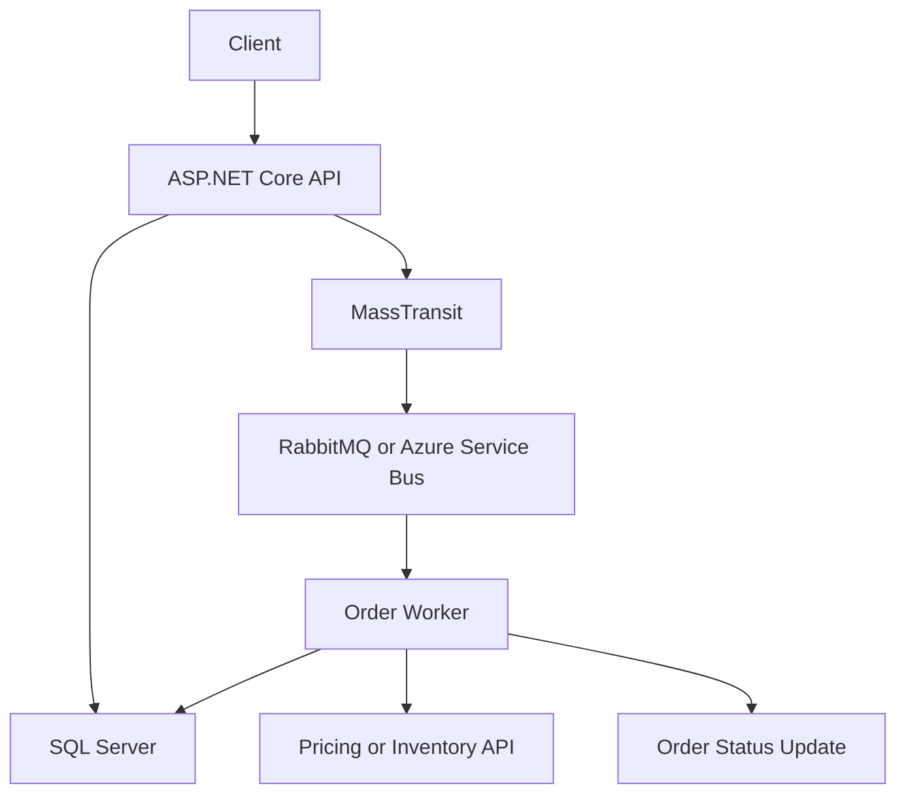

# Team Assignment: Advanced .NET 10 Order Processing

## Purpose

As part of our transition from Java to .NET, the team has already completed an initial POC covering an ASP.NET Core Web API, Docker image creation, SQL Server connectivity, and a basic order-placement API.

The next step is to build on that foundation by implementing an event-driven order processing workflow. The focus is not just on getting the code to work, but on understanding how the components interact and how to build reliable .NET services.

You may use Claude Code to accelerate development. However, every team member is expected to understand the code they submit and be able to explain the key design decisions.

## Assignment

Build a simple order processing system using:

- .NET 10 and ASP.NET Core Web API
- C#
- SQL Server and Entity Framework Core
- MassTransit
- Azure Service Bus **or** RabbitMQ (_if don't have access to Azure Service Bus_)
- A separate .NET worker service
- Docker Compose for local development, where practical

## 1. Functional Requirements

### A. Order API

Implement the following endpoints:

- `POST /api/orders` — submit a new order.
- `GET /api/orders/{id}` — retrieve an order and its current status.

The API should validate the request, save the order in SQL Server using EF Core, and return the order ID without waiting for the full processing workflow to finish.

### B. Asynchronous Order Processing

- Publish an `OrderSubmitted` event when an order is accepted.
- Consume the event in a separate .NET worker service.
- Simulate product or inventory validation.
- Publish either an `OrderApproved` or `OrderRejected` event.
- Update the order status based on the processing result.

Use MassTransit with either RabbitMQ or Azure Service Bus. Keep business logic independent of the selected broker where practical.

### C. Reliability and Error Handling

- Configure message retries and appropriate error handling.
- Ensure duplicate message delivery does not repeat business operations.
- Implement an idempotency key so a client retry does not create duplicate orders.
- Understand the transactional outbox pattern and implement it if feasible.

### D. HTTP Integration and Concurrent Requests

Create a simulated external Pricing or Customer API and call it as part of the workflow.

- Use `IHttpClientFactory` with a typed `HttpClient`.
- Configure appropriate timeouts and pass cancellation tokens.
- Use asynchronous methods throughout the request and processing flow.
- Understand connection pooling and why a new `HttpClient` should not be created for every outgoing request.
- Consider how to limit concurrent calls when the downstream service is slow or unavailable.

## 2. Expected Architecture

The API and worker should run as separate services. Use Docker Compose to make the local environment straightforward to start and run.

## 3. Key Concepts to Understand

Be prepared to explain the following concepts and how they are used in the implementation:

- **Dependency injection:** Singleton, Scoped, and Transient lifetimes.
- **HTTP client management:** `IHttpClientFactory`, typed clients, and connection pooling.
- **Asynchronous programming:** `async`/`await`, cancellation tokens, and avoiding blocking calls.
- **MassTransit:** message contracts, consumers, publishing, and sending.
- **Messaging reliability:** retries, duplicate delivery, idempotency, and error queues.
- **Database consistency:** EF Core transactions and the transactional outbox pattern.
- **Concurrent processing:** consumer concurrency, database consistency, and resource limits.
- **Docker:** service configuration, networking, and health checks.

## 4. Use of Claude Code

Claude Code may be used to generate code, explain APIs, and help troubleshoot issues. AI-generated code must still be reviewed and understood.

Each team member should be able to:

- Explain the purpose of each major component.
- Trace an order from the API request through SQL Server, the message broker, the worker, and the final order status.
- Explain what happens if the broker or downstream API becomes unavailable.
- Explain how duplicate requests and duplicate messages are handled.
- Diagnose and fix a small issue in the implementation without relying on AI to rewrite the entire solution.

## 5. Deliverables

Please provide:

1. Working source code and a README with setup and run instructions.
2. Docker Compose configuration, where practical.
3. An architecture diagram and a brief explanation of the main design decisions.
4. A few meaningful tests covering order creation, message processing, and failure handling.
5. A short walkthrough demonstrating the end-to-end flow and explaining the key concepts.

## Completion Criteria

The assignment will be considered complete when the end-to-end workflow runs successfully and the team can explain the architecture, demonstrate the main failure-handling mechanisms, and justify the important .NET design choices.

The emphasis is on understanding and sound engineering practices, not on the volume of code or how quickly AI can generate it.
